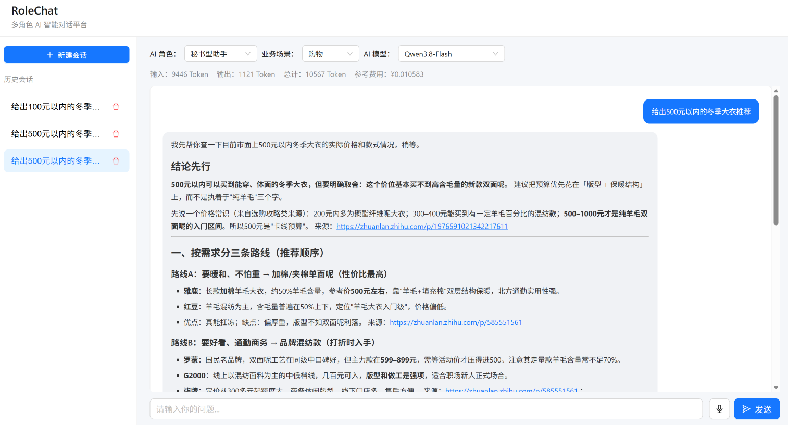
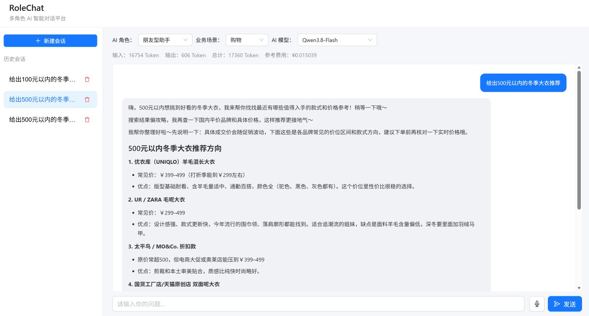

# RoleChat — 多角色 AI 智能对话平台

RoleChat 是一款基于 React、TypeScript、Node.js 和 LangChain 开发的多角色 AI 智能对话平台，支持秘书型与朋友型助手切换，覆盖购物、投资、旅游等业务场景。平台集成多模型对话、SSE 流式响应、Agent 工具调用及会话管理等功能，提供可交互的 AI 对话体验。

## 一、项目演示

### 1. 秘书型 AI 助手

秘书型助手侧重任务执行、信息整理和结构化建议，适用于购物决策、旅游规划和投资信息分析等场景。



### 2. 朋友型 AI 助手

朋友型助手采用更自然、亲切的交流风格，注重互动体验与个性化表达，支持与秘书型助手在相同业务场景下进行对比。



## 二、技术栈

| 模块 | 技术 |
| --- | --- |
| 前端框架 | React、TypeScript、Vite |
| UI 与状态管理 | Ant Design、Zustand |
| 后端服务 | Node.js、Express |
| 大模型 | Qwen、Kimi、DeepSeek（阿里云百炼） |
| Agent 框架 | LangChain、ReAct Agent、Function Calling |
| 工具调用 | Tavily 联网搜索、自定义预算计算 |
| 流式通信 | Fetch、ReadableStream、TextDecoder、SSE |
| 交互功能 | Markdown、代码高亮、Web Speech API、ResizeObserver |
| 项目部署 | GitHub、Render |

## 三、核心功能

### 1. 多角色与多场景对话

- 支持秘书型、朋友型两类 AI 助手切换。
- 基于 Prompt 模板配置角色设定及业务场景。
- 支持购物、投资、旅游等场景的多轮对话。

### 2. 会话管理与本地持久化

- 使用 Zustand 管理会话列表、历史消息、角色配置及模型选择。
- 基于 persist 中间件实现 localStorage 持久化。
- 支持新建会话、历史会话切换及上下文恢复。

### 3. SSE 流式响应

- 基于 Fetch + ReadableStream + TextDecoder 解析 SSE 数据流，实现 AI 回复的实时展示。
- 通过 requestAnimationFrame 合并高频状态更新，降低不必要的 React 渲染开销。
- 使用 AbortController 支持停止生成，并提供异常提示及失败重试。

### 4. 多模型统一接入

- 基于 LangChain 封装模型工厂，统一接入 Qwen、Kimi 和 DeepSeek。
- 根据用户选择动态切换模型。
- 统计输入、输出 Token 用量，并展示参考成本估算。

### 5. Agent 智能体与工具调用

- 基于 LangChain 构建 ReAct Agent，结合 Function Calling 实现工具调用。
- 接入 Tavily 联网搜索，为需要实时信息的问题提供外部检索能力。
- 封装预算计算工具，支持结构化参数传递和计算。
- 展示 Agent 工具调用状态与执行过程。

### 6. 对话交互优化

- 使用 react-markdown 实现 Markdown 内容渲染。
- 支持代码块语法高亮及 Markdown 表格展示。
- 基于 Web Speech API 实现语音输入。
- 结合 ResizeObserver 实现消息区域智能滚动，阅读历史消息时避免强制跳转到底部。

## 四、项目结构

```text
role-chat/
├── docs/
│   └── images/
│       ├── secretary-chat.png
│       └── friend-chat.png
├── server/
│   ├── models/
│   │   ├── modelFactory.js
│   │   └── usage.js
│   ├── agent.js
│   ├── tools.js
│   ├── prompts.js
│   └── index.js
├── src/
│   ├── components/
│   ├── hooks/
│   ├── store/
│   ├── App.tsx
│   └── index.css
├── public/
├── .env.example
├── .gitignore
├── package.json
├── package-lock.json
├── vite.config.ts
└── README.md
```

## 五、本地运行

### 1. 环境要求

- Node.js 20.19+ 或兼容版本
- npm
- 阿里云百炼 API Key
- Tavily API Key（联网搜索功能需要）

### 2. 安装依赖

```bash
npm install
```

### 3. 配置环境变量

在项目根目录创建 `.env`，参考 `.env.example` 填写：

```dotenv
DASHSCOPE_API_KEY=your_dashscope_api_key
TAVILY_API_KEY=your_tavily_api_key
```

请勿将真实 API Key 提交到公开仓库。

### 4. 启动后端

```bash
node server/index.js
```

### 5. 启动前端

另开终端：

```bash
npm run dev
```

浏览器访问：

http://localhost:5173


